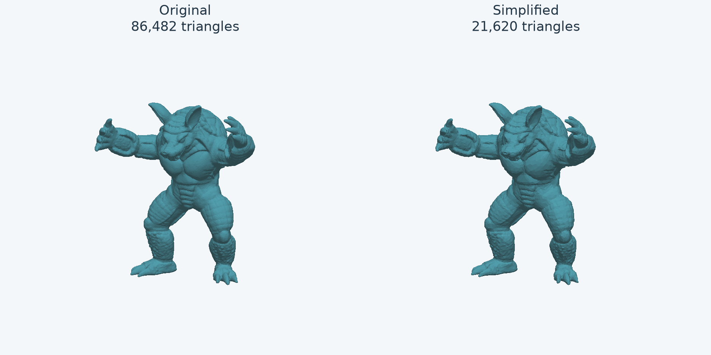

# 3D Asset Quality and Optimization Engine

How much can a 3D mesh be simplified before its shape changes too much?

This project implements mesh simplification in C++ and measures the resulting
shape loss with Python and NVIDIA Warp. It compares standard Quadric Error Metrics
(QEM) with feature-aware, curvature-weighted, and boundary-aware policies, then
reports triangle reduction, surface error, normal deviation, runtime, and memory.



Standard QEM reduced this Armadillo from 86,482 to 21,620 triangles, a 75% reduction.
The larger directional P95 surface distance, maximized across two sampling seeds,
was 0.0353% of the original bounding-box diagonal. The image is a static geometric
comparison; it does not show textures or establish visual equivalence.

## What is implemented

| Component | Implementation |
|---|---|
| Mesh inspection | C++17 OBJ loader, geometry diagnostics, normalization, and export |
| Simplification | Custom QEM edge collapse, connectivity updates, priority queue, and collapse validation |
| Alternative policies | Crease constraints and penalties, curvature-proxy weighting, constrained boundary chains |
| Quality evaluation | Seeded surface sampling and bidirectional Warp closest-point queries; normal, crease, and boundary metrics |
| Experiments | Multi-asset budget sweeps, policy ablations, CSV/JSON reports, and comparison plots |
| Performance study | Stage timers, queue counters, repeated unprofiled trials, process peak RSS, and output-hash checks |

The C++ optimizer and the evaluation/experiment workflow are implemented in this
repository. Warp supplies triangle-surface queries; NumPy handles sampling and
statistics; Matplotlib generates reports. The project uses established QEM ideas
and evaluates policy choices rather than claiming a new simplification algorithm.

Meshy exports are an intended input source. Models are supplied as triangulated
OBJ files through the CLI; Meshy API integration and a web viewer are not implemented.
The experiments below use a Stanford scan and procedural meshes, not a validated
corpus of AI-generated assets.

## Quick start

Run from the repository root. Requirements: C++17 compiler, CMake 3.16+, and Python
3.10+. These commands use macOS/Linux virtual-environment paths; see the
[usage guide](docs/guide.md#build-and-install) for a direct compiler build and Windows notes.

```sh
cmake -S . -B build -DCMAKE_BUILD_TYPE=Release
cmake --build build --config Release

python3 -m venv .venv
.venv/bin/python -m pip install -e '.[benchmark]'
```

Generate a sample locally, then run inspection, simplification, and evaluation in
one command. No downloaded model or API key is needed:

```sh
PYTHONPATH=python .venv/bin/python -m assetq.examples outputs/demo/rippled-box.obj

PYTHONPATH=python .venv/bin/python -m assetq benchmark \
  outputs/demo/rippled-box.obj \
  --output-dir outputs/demo-run \
  --retain 0.75 0.5 0.25 \
  --methods standard feature \
  --samples 20000 --seeds 42 43
```

Open `outputs/demo-run/report.md` for the comparison table and plots. The run also
saves simplified OBJs, full JSON metrics, a flat CSV, inspections, and command logs.
Use a new or empty benchmark directory for each run. For a real asset, replace the
generated OBJ path with the path to an existing triangulated export.

Inspection and simplification need no third-party Python runtime packages.
Evaluation uses the `evaluation` extra; `benchmark` adds plotting. CPU Warp is the
default and was tested on Apple Silicon; CUDA evaluation requires a supported
NVIDIA environment.

## How it works

```text
Triangle OBJ → inspect → C++ simplification → Warp evaluation → tradeoff report
```

1. Inspect vertices, triangles, file size, bounds, and geometry defects.
2. Build vertex quadrics from original face planes and rank edge-collapse candidates.
3. Reject invalid collapses and update neighboring candidates until reaching the
   triangle budget or exhausting valid choices.
4. Sample both surfaces and query the other triangle mesh for closest points.
5. Compare measured error against actual triangle reduction. An optional threshold
   selects the smallest tested version passing every requested seed.

Each triangle budget starts from the original mesh. Reports distinguish requested
and achieved counts. Invalid collapses can leave a mesh above its target.

| Policy | Purpose |
|---|---|
| `standard` | Reference QEM objective with conservative topology checks |
| `constraints` | Benchmark ablation: crease graph, corner protection, and segment constraints without extra crease-plane penalties |
| `feature` | Add crease-plane penalties to those feature constraints |
| `curvature` | Weight original face quadrics using a capped normal-variation proxy |
| `combined` | Combine curvature weighting with feature constraints and penalties |
| `boundary` | Benchmark alias for standard QEM with controlled open-boundary collapses |

Boundary locking remains the default. Standalone simplification accepts
`--boundary-policy chain` with any local quadric method. Sorted-vector queue
refresh is the default; the previous tree-based path remains available for comparison.
See the [implementation reference](docs/guide.md) for formulas, parameters, and CLI options.

## What the experiments show

The results show tradeoffs rather than one policy winning everywhere:

- Standard QEM had lower surface P95 than the tested feature/curvature variants on
  Armadillo at 25% retained triangles.
- On a curved mechanical box at the same 432-triangle count, feature constraints
  preserved the sampled crease network to numerical precision, but surface P95
  increased from 0.0782% to 0.0865% of the original diagonal.
- Boundary-chain reduction simplified a narrow strip from 22 to 5 triangles where
  locking prevented reduction. Curved-outline movement remained measurable.
- Replacing temporary tree sets with sorted vectors reduced Armadillo's observed
  median optimizer time from 2.38 s to 2.10 s, with byte-identical output. Trial
  variability was substantial; no meaningful memory reduction was established.

The performance comparison used five unprofiled measured trials per variant,
separate warm-ups, and separate diagnostic profiles. Sampling seeds are quality
trials, not repeated timing trials. These results are preliminary development
measurements on one host, not cross-hardware performance claims.

[Read the experiment setup, numerical tables, and limitations](docs/results.md).
Selected numerical summaries and charts are committed under `docs/`; full run
folders and downloaded assets remain local under ignored `outputs/`.

## Reading the metrics

Distance errors are normalized by the original model's bounding-box diagonal.
JSON/CSV store fractions; plots and result tables use percentages. A P95 of 0.0353%
corresponds to about 0.353 mm for a model with a one-meter diagonal. It is a sampled
distance tolerance, not an accuracy percentage.

Normal deviation uses oriented geometric face normals at nearest surface points.
Crease and boundary metrics use length-weighted samples and nearest-segment queries.
Missing feature networks are flagged as N/A rather than assigned zero error.
Sampled maximum distance is not exact Hausdorff distance, and low geometric error
does not establish texture, shading, or semantic fidelity.

## Validation and current limits

The current suite has 62 tests covering analytic distances, sampling, topology,
policy ablations, boundaries and holes, deterministic exports, failure handling,
and profiling. Selected C++ cases also passed address/undefined-behavior sanitizers.

```sh
.venv/bin/python -m unittest discover -s tests -v
```

Optional evaluation, plotting, and performance tests skip when dependencies are
missing. Important constraints remain:

- Triangle OBJ geometry only; exported files omit UVs, normals, textures, and materials.
- Simplification requires non-degenerate, non-duplicate, consistently wound manifold
  input. Automatic repair and global self-intersection detection are not implemented.
- Curvature weighting is a tessellation-dependent heuristic; feature and boundary
  policies can restrict reductions or worsen other error metrics.
- Evaluation uses float32 queries and finite samples; small features may be missed.
- An external `fast-simplification` adapter is implemented but has not been validated
  against an installed reference library. The reported comparisons use local methods.

Next priorities are external-baseline execution, broader real-asset validation,
error-constrained budget refinement, and synchronized visual comparisons.

## Code and documentation

- [`cpp/src/simplify.cpp`](cpp/src/simplify.cpp): quadrics, candidates, collapse validation, connectivity, and policies.
- [`python/assetq/evaluate.py`](python/assetq/evaluate.py): sampling and geometry metrics.
- [`python/assetq/benchmark.py`](python/assetq/benchmark.py): quality experiments and reports.
- [`python/assetq/performance.py`](python/assetq/performance.py): timing and memory trials.
- [`tests/`](tests/): reference cases and integration checks.
- [Usage and implementation guide](docs/guide.md) · [Experiment results](docs/results.md).

## References and attribution

- [Garland and Heckbert, Surface Simplification Using Quadric Error Metrics (1997)](https://www.cs.cmu.edu/~garland/quadrics/).
- [NVIDIA Warp](https://github.com/NVIDIA/warp): geometry-query backend.
- [Stanford 3D Scanning Repository](https://graphics.stanford.edu/data/3Dscanrep/): Armadillo reference model, obtained through [libigl tutorial data](https://github.com/libigl/libigl-tutorial-data).
- [fast-simplification](https://github.com/pyvista/fast-simplification): optional external reference adapter.
