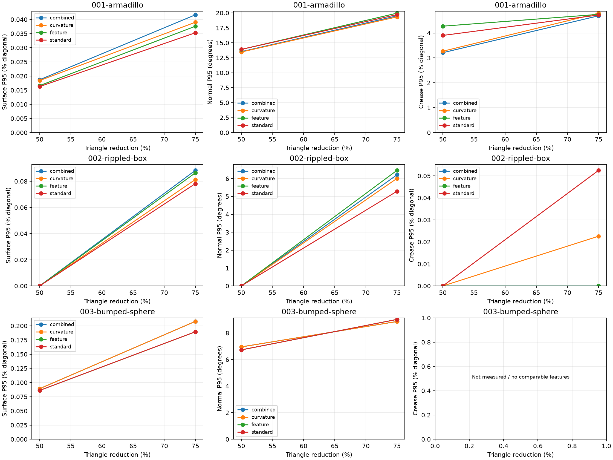
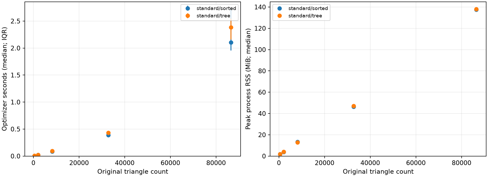

# Experiment results

[Project overview](../README.md) · [Usage and implementation guide](guide.md) · [Numerical snapshot](data/results.json)

These are development experiments on one host. The comparison corpus consists of
a Stanford Armadillo scan and procedural geometry. Results do not establish broad
performance on AI-generated assets, cross-hardware speedups, or algorithmic novelty.

The selected numerical summaries and figures on this page are tracked in Git.
Full reports, trial logs, meshes, and downloaded assets are generated under
`outputs/` and are not part of a fresh clone. Commands below regenerate procedural
inputs and new experiment reports. Armadillo is an additional downloaded reference,
credited to the [Stanford scanning repository](https://graphics.stanford.edu/data/3Dscanrep/)
and obtained through [libigl tutorial data](https://github.com/libigl/libigl-tutorial-data).

## Shape reduction

Standard QEM on Armadillo, starting from 86,482 triangles:

| Target retention | Achieved triangles | Surface P95 (% original diagonal) |
|---|---:|---:|
| 75% | 64,862 | 0.007764 |
| 50% | 43,242 | 0.016282 |
| 25% | 21,620 | 0.035296 |

The exact snapshot values are in `data/results.json`; the rounded display values
above use the larger directional P95, maximized over seeds 42 and 43. Each seed
uses 100,000 samples per direction. The 75% and 50% target budgets were odd counts;
valid interior collapses remove two faces, so these runs stopped one face above
the target. Surface distance is measured against triangles, not sampled target
points or target vertices.

## Method ablations



The figure compares standard, feature, curvature, and combined policies at 50%
and 25% retained triangles. Feature angle is 45 degrees, feature-plane weight 10,
and curvature strength 4. Samples: 100,000 surface points and 2,000 feature-network
points per direction, seeds 42 and 43. The crease proxy and curvature estimator
have different roles: one identifies dihedral edges; the other weights face quadrics
by capped local normal variation.

At 25% retained triangles on Armadillo:

| Policy | Achieved triangles | Surface P95 (% diagonal) | Normal P95 (degrees) |
|---|---:|---:|---:|
| Standard | 21,620 | 0.035296 | 19.7136 |
| Feature | 21,620 | 0.037611 | 19.9595 |
| Curvature | 21,620 | 0.039023 | 19.3335 |
| Combined | 21,620 | 0.041652 | 19.5067 |

Standard QEM has the lowest surface P95 here. Curvature weighting slightly lowers
the measured normal P95 at the cost of higher positional error. Two seeds do not
establish statistical significance or visual preference.

On the procedural rippled box at 432 triangles, standard QEM has surface P95
0.078225% and crease P95 0.052515% of diagonal. Feature constraints reduce sampled
crease error to numerical precision, while surface P95 increases to 0.086467%.
Constraints alone and constraints plus feature-plane penalties give the same
scores in this case. The additional penalty is not an independently demonstrated
benefit on that fixture. Normal and crease metrics can disagree with surface error;
independently thresholded crease networks are sensitive to changes in face normals.

The earlier three-method experiment ran 54 evaluations; the curvature experiment
shown above ran 48. Numerical summaries from both are retained in the snapshot.
Comparisons only receive numerical deltas when achieved counts match exactly and
all requested seeds complete. No interpolation or universal policy ranking is used.

## Open-boundary reduction

Four synthetic inputs, two policies, two budgets, and two seeds produced 32
successful evaluations. At the 25%-retained target:

| Input | Target triangles | Locked achieved | Chain achieved |
|---|---:|---:|---:|
| Open plane | 60 | 60 | 60 |
| Plane with square hole | 52 | 68 | 52 |
| Narrow strip | 5 | 22 | 5 |
| Curved patch | 60 | 60 | 60 |

On the curved patch at 60 triangles, chain reduction lowered surface P95 from
0.220952% to 0.151711% of diagonal, but boundary P95 was 0.178078%. Locking kept
the original boundary at numerical precision. The improvement in surface fit
therefore came with outline movement.

Checks on every export preserved boundary-loop count and Euler characteristic
and found no degenerate/duplicate triangles, non-manifold edges, or inconsistent
winding. These checks do not establish absence of geometric self-intersections.
The strip and hole results demonstrate budget reachability; their different
achieved counts preclude equal-count quality claims.

## Profiling-driven optimization



An initial Armadillo profile attributed approximately 33% of optimizer time to
candidate refresh and 25% to queue popping. Replacing a temporary ordered set with
a vector followed by sorting and deduplication reduced bookkeeping allocations,
while retaining the same candidate enqueue order.

The study used standard QEM at 25% retained triangles, one excluded warm-up,
five measured unprofiled trials per variant, and a separate profiled execution.
Variant order alternated. The four small inputs are one bumped-sphere family;
Armadillo is a different asset. Total: 70 executions, including 50 measured trials.

| Input triangles | Tree median seconds | Sorted median seconds | Observed time reduction |
|---:|---:|---:|---:|
| 512 | 0.005893 | 0.005187 | 12.0% |
| 2,048 | 0.023326 | 0.020842 | 10.7% |
| 8,192 | 0.095316 | 0.086625 | 9.1% |
| 32,768 | 0.432138 | 0.387484 | 10.3% |
| 86,482 (Armadillo) | 2.383593 | 2.102676 | 11.8% |

Armadillo IQR was 0.384063 s for tree and 0.766830 s for sorted. The substantial
overlapping variability limits confidence in the exact improvement. Median peak
RSS was 138.03 versus 137.58 MiB; no meaningful memory reduction is established.
Both paths produced identical OBJ hashes in every case, including profiles and
warm-ups. Armadillo also matched an independently saved pre-optimization mesh.

Build: Apple clang, C++17, `-O2 -Wall -Wextra -Wpedantic -Werror`, Darwin/arm64.
Exact CPU branding was unavailable in the sandbox. Build label, compiler version,
environment, executable hash, timing distributions, and paired comparisons are
included in the snapshot. Hardware load and thermal state were uncontrolled.

Each run starts a fresh process. Warm-ups warm OS/file caches; they do not retain
an optimizer. Process wall time includes startup and I/O. Optimizer time excludes
mesh I/O and engine destruction. Peak RSS is the process lifetime high-water mark,
not optimizer-only memory. Profile times are diagnostic and excluded from timing
summaries. Stale queue churn remains: Armadillo discarded 867,057 stale entries
out of 899,579 pops in both paths. No external-simplifier speed claim is made.

## Reproduce procedural comparisons

After the [quick-start installation](../README.md#quick-start), run from the repository root:

```sh
PYTHONPATH=python .venv/bin/python -m assetq.examples outputs/examples/rippled-box.obj
PYTHONPATH=python .venv/bin/python -m assetq.examples outputs/examples/bumped-sphere.obj --shape bumped-sphere

PYTHONPATH=python .venv/bin/python -m assetq benchmark \
  outputs/examples/rippled-box.obj outputs/examples/bumped-sphere.obj \
  --output-dir outputs/method-run \
  --methods standard constraints feature curvature combined \
  --retain 0.5 0.25 --samples 100000 --feature-samples 2000 --seeds 42 43

PYTHONPATH=python .venv/bin/python -m assetq.examples outputs/examples/open-hole.obj --shape open-hole
PYTHONPATH=python .venv/bin/python -m assetq benchmark \
  outputs/examples/open-hole.obj --output-dir outputs/boundary-run \
  --methods standard boundary --retain 0.5 0.25 --seeds 42 43

PYTHONPATH=python .venv/bin/python -m assetq performance \
  outputs/examples/bumped-sphere.obj --output-dir outputs/timing-run \
  --variants tree sorted --retain 0.25 --warmups 1 --repeats 5 \
  --build-label 'Record your actual compiler and flags'
```

Use a new or empty run directory each time. `assetq.examples --levels 3` through
`--levels 6` generates the bumped-sphere sizes used in the timing study. The
[usage guide](guide.md) describes external-reference setup and all command options.

To regenerate the README render after obtaining the reference model:

```sh
.venv/bin/python docs/render_comparison.py \
  outputs/sample-model/armadillo.obj \
  outputs/model-versions/mesh-21620.obj
```

The render uses one camera, shared bounds, and geometric flat shading. It provides
visual context alongside the numerical metrics, not an appearance-fidelity test.
